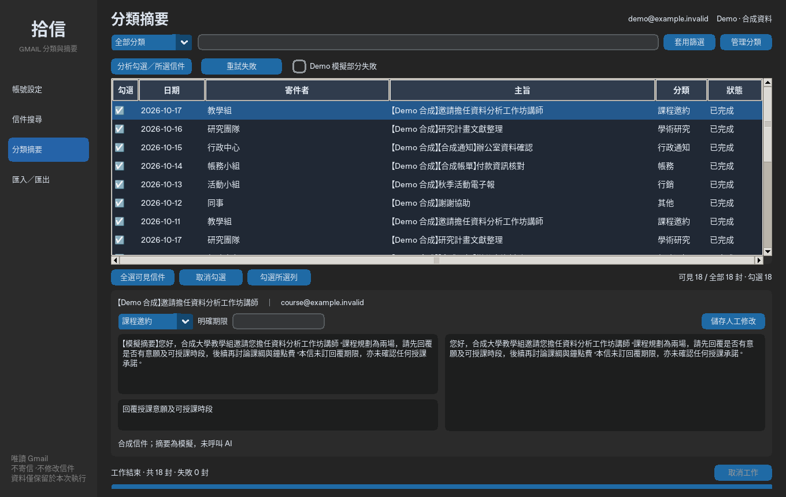

# CodexAPP · 拾信 Gmail 分類與摘要桌面 App

Python 3.12＋CustomTkinter，繁體中文介面。信件與摘要只使用記憶體 list／dict，不使用 SQLite 或其他資料庫。可先透過 Demo 體驗完整流程，再由開發者配置真實 Gmail 與模型 API。



## Windows 快速啟動

1. 安裝 [Python 3.12](https://www.python.org/downloads/windows/) 64 位元，包含 Tcl/Tk、pip、Python Launcher（`py`）。
2. 在本專案雙擊 `start.bat`，首次會建立 `.venv` 並依 `requirements.lock` 的版本與 SHA-256 安裝依賴。
3. 首頁按「進入 Demo（無需帳號）」。或在命令提示字元執行：

```bat
start.bat --demo
```

Demo 信件、姓名、Email、期限與摘要都是明確標示的合成資料；不會存取 Google 或模型服務。首頁可選深色／淺色、視窗可縮放；CustomTkinter 自動啟用 Windows DPI 感知，Treeview 配色隨模式更新。

若 Windows 顯示縮放大於 150%，可使用帳號頁的捲動區與信件表格的水平捲軸；建議 1360×860 以上的邏輯畫面空間。真實 Windows 高 DPI 尚待驗收。

## 操作流程

1. 首頁按 Google 登入或 Demo。首次 Google 授權在**系統瀏覽器**同時選擇帳號並同意 Gmail 唯讀讀取。未授權 Gmail 無法讀信。
2. 「信件搜尋」預設台北時間最近七天、最多 50 封；可調日期、寄件者、主旨、未讀、進階 Gmail 查詢。結束日期包含當日；進階條件以括號組合。Demo 不模擬任意 Gmail 進階語法，會明確提示。
3. 搜尋表格顯示本次查詢結果；分類摘要頁則累積同一帳號的本次工作階段資料，以帳號＋信件 ID 去重。每封信各自保留，**同主旨不合併**。切換帳號會清空前一帳號資料。
4. 雙擊表格第一欄勾選、Ctrl／Shift 多選、空白鍵勾選或按全選。「分類摘要」按「分析勾選／所選信件」。勾選優先於表格反白；全選僅套用可見列，隱藏列的原有勾選會保留，總勾選數顯示於表格下方。
5. 真實模式分析前會列出供應商、HTTPS 網址、模型、送出封數、欄位及正文上限，由使用者確認。Google 登入、ChatGPT 訂閱**不代表有 API 額度**。
6. 選一封信可看唯讀正文、內容限制、錯誤及摘要；左側摘要、待辦、分類、期限可人工修改。「儲存人工修改」、換列、切換頁面或匯出時，修改會先保留至記憶體。
7. 可取消工作，已完成的結果保留；取消在下一個處理界線生效，不強制中斷進行中的網路請求。Gmail 呼叫約 30 秒，模型讀取逾時 60 秒，Google 瀏覽器授權最長 180 秒；憑證更新使用 Google 函式庫逾時。進行中會鎖定編輯及帳號切換。
8. Demo 勾選「模擬部分失敗」後分析全部，`demo-003` 會首次失敗，再按「重試失敗」即可成功。真實模式也支援讀取及分析失敗重試；若兩類皆存在，先重試讀取，再次點擊處理分析失敗。
9. 「匯入／匯出」保存 UTF-8 BOM CSV。部分匯出不會將其他未保存資料標為已保存。CSV 含私人摘要，請妥善保存。
10. CSV 匯入支援查看及編輯；無原文時不允許分析。登入同一 Gmail 帳號重新搜尋相同 ID 可補回正文，保留人工修改；之後可重新分析。每個 CSV 只允許一個帳號，重複 ID 保留記憶體內原有資料。

分類可新增、改名、刪除；刪除時必須指定替代分類，至少保留一類。關閉、登出或切換帳號會提示先匯出未保存資料。

## 真實 Gmail 與 AI 設定

- **開發者**依 [OAuth 設定與發布要求](docs/OAUTH.md) 預先配置 Desktop OAuth 用戶端與 Gmail API；終端使用者不用建立 Cloud 專案或匯入憑證。沒有配置時 Google 登入會顯示具體提示，Demo 可正常使用。
- 啟動時自動從 OS keyring 恢復授權並更新過期憑證。授權撤銷或 refresh token 無法使用時提示重新登入；暫時斷網保留憑證，按「重新連線」重試。
- 真實模式的登出移除本機 Google Token；不等於在 Google 帳號撤銷整個 App 的授權。需撤銷可到 Google 帳號「第三方連線」移除。Demo 離開工作階段不修改先前 Google keyring 授權。
- 在「帳號設定」選 OpenAI 或支援 `/chat/completions`、`response_format: json_object` 的 OpenAI 相容服務，設定模型、HTTPS 基礎網址與 key。OpenAI 選項固定官方網址；其他服務選「OpenAI 相容」。模型是否可用取決於帳號與供應商。
- API key 僅存於該供應商／網址的 keyring 位置；留空沿用。變更網址不會挪用舊網址的 key，避免誤送；可刪除目前服務的 key。
- 一般偏好在 `%LOCALAPPDATA%\GmailSummary\preferences.json`，僅含外觀、分類、供應商、模型、網址與正文長度。Token、refresh token、API key 不寫入 JSON、CSV、程式碼或日誌。
- 無安全 OS keyring 時拒絕明文回退；Windows 使用 Windows Credential Manager。Linux 若只有 headless 環境可使用 Demo；真實模式需要已解鎖的 Secret Service。

## 開發與測試

```bash
uv sync --frozen
uv run --frozen python -m gmail_summary --demo
uv run --frozen python -m pytest -q
uv run --frozen ruff check gmail_summary tests desktop_entry.py
```

也可用 `python -m pip install --require-hashes -r requirements-dev.lock` 安裝完整開發環境。請從專案根目錄執行。`uv.lock`、`requirements.lock`、`requirements-dev.lock` 鎖定直接與傳遞依賴；更新時以 `uv lock` 再 `uv export --frozen --no-dev --no-emit-project -o requirements.lock` 及 `uv export --frozen --no-emit-project -o requirements-dev.lock` 同步。

無顯示器時核心測試可跑，桌面測試會清楚 skip。若 Linux 已安裝 Xvfb：`xvfb-run -a uv run --frozen python -m pytest -q`。本次使用 Xorg dummy 虛擬桌面實際跑 UI 測試，沒有把跳過視為通過。此雲端便攜 Python 3.12 的 Tk 9 缺少 CJK 字型支援，操作測試雖通過，截圖中文字無法正常顯示；因此另以系統 Python 3.13＋Tk 8.6 重跑全部測試並確認中文畫面。Linux 若遇到相同問題，請使用具 Xft／中文字型的系統 Tk；Windows 建議使用官方 Python 3.12 安裝版附帶的 Tcl/Tk。

## Windows 打包

**先用 onedir**，在 Windows 專案目錄執行：

```bat
build_windows.bat
```

輸出 `dist\GmailSummary\GmailSummary.exe`。保留整個 `GmailSummary` 資料夾（包含 `_internal`）。打包腳本先執行測試；實機不得跳過桌面驗收。

確認 onedir 可用後，才用 onefile：

```bat
build_windows.bat onefile
```

輸出 `dist\GmailSummary.exe`，首次解壓載入通常較慢。`GmailSummary.spec` 明確收集 CustomTkinter、時區、Gmail API 描述與 keyring 資源，沒有收集設定目錄、工作區、匯出信件或任何憑證。OAuth 客戶設定由開發者安裝在 exe 旁，**不嵌入 exe**。不要手動加入私人憑證、Token、模型 key 或開發者秘密。

PyInstaller 不能從此 Linux 環境交叉產生 Windows exe；spec 在非 Windows 平台明確拒絕，避免誤標。正式發行還需依 [驗證紀錄](docs/VALIDATION.md) 完成實機測試、簽章與安全檢查。

## 架構與資料界線

- `ui.py`：CustomTkinter／ttk；所有 Tk 操作位於主執行緒。
- `workers.py`：背景 Thread＋queue；主執行緒每 80ms 以 `after()` 接收結果。取消以 Event 控制。
- `auth.py`／`security.py`：官方 InstalledAppFlow、PKCE、loopback、唯讀 scope、OS keyring。
- `gmail.py`：分頁、MIME、文字／HTML 解析；不載入網頁、追蹤圖片或附件，不呼叫修改、寄信或刪信 API。
- `ai.py`：可替換的獨立 AI 服務模組，結構化輸出、分類驗證、期限原文引句檢查。信件指令僅視為資料，沒有工具或執行能力。
- `models.py`／`csvio.py`／`settings.py`：記憶體資料、UTF-8 BOM、CSV 公式防護、非秘密 JSON。
- `demo.py`：合成信件及模擬摘要，使用相同搜尋／分析事件與 UI。

不保證模型能完全避免事實錯誤。程式以指示限制、期限原文證據與內容限制提示降低風險；日期、金額、人物及承諾仍應人工核對。不把 HTML 中的隱藏指令視為可信命令。未提供的附件、以附件形式提供的正文與轉寄 `.eml` 不自動讀取，會標示可辨識的內容限制。
