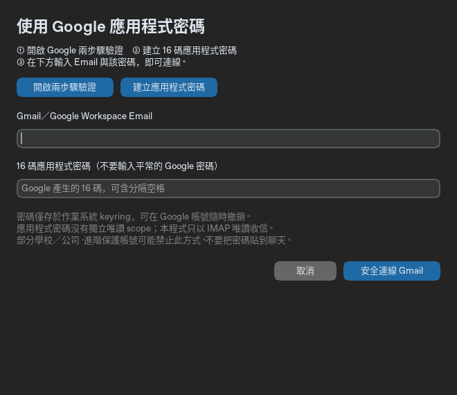

# Gmail 快速連線：不需要 Google Cloud Console

版本 0.2.0 新增的方式。請下載新版專案後執行 `start.bat`；如果首頁仍只有「使用 Google 帳號登入」，表示你開啟的是舊版資料夾。

## 三個步驟

1. 用準備收信的 Google 帳號開啟 [兩步驟驗證](https://myaccount.google.com/signinoptions/two-step-verification)，依 Google 畫面完成啟用。
2. 開啟 [應用程式密碼](https://myaccount.google.com/apppasswords)。若 Google 要求重新驗證，請在 Google 官方網頁操作。應用程式名稱填「拾信」，建立後得到 16 碼應用程式密碼。
3. App 首頁按 **「連線 Gmail（免 Cloud 設定）」**，輸入完整 Gmail 地址與剛產生的 16 碼密碼，按「安全連線 Gmail」。可貼上 Google 顯示的含分隔空格格式，程式會自動移除空格。

登入視窗也有兩個按鈕可直接開啟上述 Google 官方網頁。**不要輸入一般 Google 密碼，不要把應用程式密碼貼到聊天、原始碼或 GitHub。** 不需要建立 Cloud 專案、啟用 Gmail API 或匯入 OAuth JSON。

成功後顯示「已連線 · IMAP 程式唯讀」。到「信件搜尋」搜尋，再到「分類摘要」處理；真實 AI 摘要仍需另外設定供應商、模型與 API key。Google 連線不包含 AI 配額。

## 沒有應用程式密碼選項

先確認用的是同一個 Google 帳號，且已完成兩步驟驗證。Google 可能因學校／公司管理政策、進階保護、僅允許安全金鑰等帳號條件而不提供應用程式密碼。若顯示帳號不適用，不能用一般 Google 密碼取代，也不能繞過限制；請聯絡管理員、改用進階 OAuth，或繼續 Demo。

Google 官方說明：[使用應用程式密碼登入](https://support.google.com/accounts/answer/185833?hl=zh-Hant)、[在其他郵件用戶端查看 Gmail](https://support.google.com/mail/answer/7126229?hl=zh-Hant)。本次開發環境讀取 support.google.com 被代理 403 阻擋，未宣稱完成即時政策查核；實際資格以 Google 帳號頁面為準。

## 密碼保存與撤銷

- Email 與應用程式密碼一起只存於作業系統 keyring 的 `GmailSummaryDesktop / gmail-imap-current`。一般 JSON 只記錄登入方式，不含密碼或信件。
- 重啟自動恢復。暫時網路／TLS 問題保留密碼；Gmail 拒絕驗證時提示重新建立，並移除同帳號失效的本機記錄。
- App 登出移除本機 Gmail 憑證。要在 Google 全面撤銷此應用程式密碼，可回應用程式密碼頁刪除「拾信」。Google 密碼變更也可能撤銷既有應用程式密碼。
- 沒有安全 OS keyring 時拒絕保存；不回退明文檔案。Windows 使用認證管理員。Demo 不需要 keyring，也不影響既有真實登入。
- 成功切換 IMAP／OAuth 後，移除另一種登入方式的本機 Gmail 憑證，避免下次自動連到舊帳號。切換失敗則保留原工作階段及另一帳號原有憑證。

## 讀取範圍與限制

應用程式密碼本身不像 OAuth `gmail.readonly` 有獨立的唯讀 scope。**本程式**透過驗證 TLS 的 `imap.gmail.com:993` 連線，使用唯讀 EXAMINE 開啟「所有郵件」、UID SEARCH 查詢及 BODY.PEEK 讀正文，沒有 STORE、EXPUNGE、APPEND、SMTP、寄信或刪信操作。

正文先讀 MIME 結構，再只讀適合的文字／HTML 部分；不整封下載，因此不會順帶抓到附件。純文字優先、HTML 轉文字且不載入圖片。每段正文最多讀取 2 MiB，超過明確標示。若找不到 Gmail「所有郵件」資料夾，回退收件匣並標示搜尋範圍限制。

日期、寄件者、主旨、未讀與進階條件共用 Gmail 查詢語法，中文條件以 IMAP literal 傳送。取得 UID 後分批處理、可取消及重試；取消等待目前請求返回，socket 逾時約 30 秒。資料、CSV、人工修改及 AI 流程共用原有介面。附件內容不傳給 AI。

本次已用模擬 IMAP 伺服器回應驗證協定命令、TLS 設定、認證保存／失效、正文解析、分批／上限／去重／取消與重試。沒有使用真實 Gmail 應用程式密碼，真實連線及 Windows keyring 仍待實機驗收。
